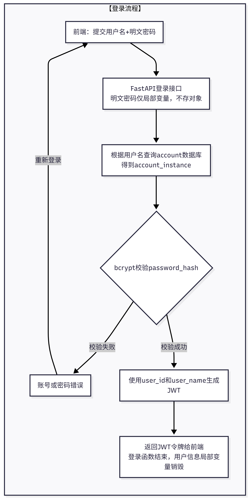
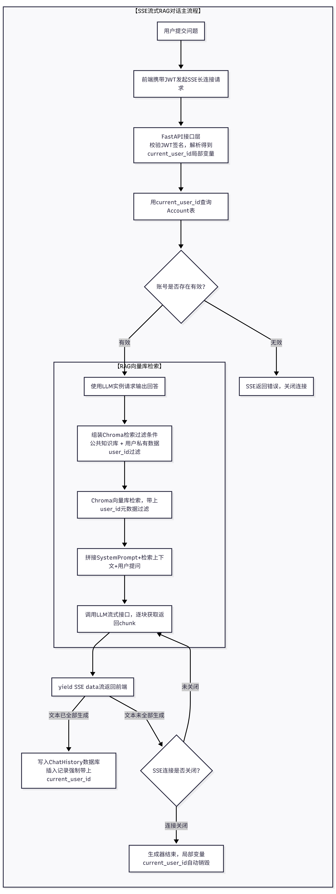

## AI_agent
基于 Ollama + LangChain 搭建本地AI Agent学习项目

# 快速开始

## 环境安装
请在 https://ollama.com/download 中下载ollama客户端

在cmd中使用 ollama pull qwen2:7b 下载qwen2:7b模型

使用ollama pull nomic-embed-text 下载nomic-embed-text模型

运行前请使用 pip install -r requirements.txt 命令安装代码必要的依赖模块

## 初次运行
打开start_server.py文件，使用Pycharm等IDE直接运行，运行成功时会自动弹出两个页面，一个Swagger UI页面作为账号登录，SSE RAG测试页面作为垂钓QA使用。

在Swagger UI页面进行账号登录时，请先点击右上角的Authorize，输出username和password即可，client不需要输入，如果登录成功，则会显示Authorized。

登录成功之后，点击default中的GET /me Get Profile，再点击Try it out，最后选择Execute，成功状态下会输出Response Code 200，可以在curl中最后一行Authorization: Bearer中找到自己的token，也就是Bearer后面的一大串字符串。

最后将这串token粘贴在SSE RAG测试页面的token处即可使用垂钓Agent聊天功能。

# 项目流程图

# 项目状态与待办清单

## 已完成
- 垂钓公共知识库处理：文档切片、Embedding流水线，搭建Chroma向量库
- FastAPI后端基础服务，SSE大模型流式输出能力
- JWT登录注册鉴权接口，密码bcrypt哈希存储，不保存明文密码
- 基础RAG完整链路：用户提问 → 向量检索 → LLM推理返回结果
- 聊天记录数据库持久化，所有查询强制携带 user_id，实现用户数据隔离
- Account类重构为无状态；用户身份信息以函数入参传递，不挂载实例self，规避SSE并发下用户串号越权风险

## 开发中
- 优化RAG检索效果，改善垂钓专有名词召回不稳定问题
- 调研并落地缓解大模型幻觉的工程方案
- SSE长连接异常捕获与连接断开后的资源回收逻辑

## 待实现：安全与架构优化
- Access‑Token + Refresh‑Token 双令牌方案，Token存放至 HttpOnly Secure Cookie
- Redis实现JWT黑名单，支持登出、修改密码后作废未过期令牌
- Redis接口限流；强化请求入参校验；增加Prompt注入防护
- Chroma向量库完善元数据过滤，区分公共知识库 / 用户私有知识库，为用户上传私有文档做兼容
- 全局统一异常捕获处理；增加携带用户ID的操作审计日志

## 待实现：业务功能迭代
- 简易Web前端界面（目前仅可调用后端API）
- 支持用户上传私有垂钓笔记，启用私有向量知识库隔离
- 会话管理：会话列表、删除会话、会话重命名
- Agent部分参数可配置入口

## 待实现：中长期AIGC拓展
- 接入图像生成模型，实现垂钓领域示意图生成（调漂示意图、钓组搭配、装备参考图）
- 打通图文链路，RAG检索后触发图像生成，输出图文结合的Agent回答

## 锦上添花（低优先级）
- Docker容器化部署
- 本地部署使用文档
- 简单接口性能压测

# 版本更新记录

## 版本v0.1
终端交互对话程序，使用qwen2:7b模型 - 2026.08.15：

## 版本v0.2
### v0.2.0
终端交互对话程序，使用qwen2:7b模型

添加流式输出和上下文记忆功能 - 2026.08.15

### v0.2.1
添加上下文记忆清理功能 - 2026.08.15

## 版本v0.3
新增钓鱼RAG向量知识库，使用nomic-embed-text模型 - 2026.08.20

## 版本v0.4
重构代码，将I/O与业务分层 - 2026.08.20

## 版本v0.5
### v0.5.0
添加账密系统，账户会连入数据库 - 2026.08.21

### v0.5.1
优化Agent参数，解决了部分回答不准确的问题 - 2026.08.22

## 版本v0.6
### v0.6.0
添加jwt鉴权功能，生成access token - 2026.08.24

### v0.6.1
添加Swagger UI页面测试文件，作为账号登录测试 - 2026.08.25

### v0.6.2
优化Agent参数，解决了部分回答不准确的问题
添加SSE RAG测试页面作为垂钓聊天简易UI - 2026.08.25

### v0.6.3
重构代码，隔离了测试层和功能层 - 2026.08.25

### v0.6.4
重构代码，添加了一些异常处理 - 2026.09.01

## 版本v0.7
### v0.7.0
将上下文历史对话移动到数据库中，最多保存6条最近的记录 - 2026.09.02

### v0.7.1
重构代码，修改账号密码存储逻辑 - 2026.09.02

### v0.7.2
重构代码，将数据库操作和业务层隔离 - 2026.09.04

### v0.7.3
重构代码，将数据库连接、断开等操作整合成上下文管理器
增加token在有效期10分钟内重新签发的功能、添加一个前端demo - 2026.09.04

